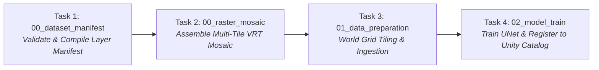

# Databricks Asset Bundle (DABs) Deployment

This directory contains the reference Databricks Asset Bundle (DABs) definition for orchestrating the `landseg` interactive and production notebook pipeline on Databricks GPU compute clusters, as formalized in **ADR-0066**.

---

## 1. Pipeline Architecture

The workflow (`landseg_pipeline_workflow`) automatically chains the four canonical notebooks in sequential execution tasks:



### Storage Architecture (Two-Tier Model)
- **Persistent Tier (Unity Catalog Volumes)**: The workspace root is parameterized via `exp_root` pointing to `/Volumes/<catalog>/<schema>/<volume>/experiment`. Raw imagery, dataset manifests, world grids, ingested tensor blocks, evaluation metrics, and final model checkpoints persist here across runs.
- **Scratch Tier (Driver `/tmp`)**: Optuna hyperparameter sweeps automatically route SQLite trial databases to driver-local disk (`sqlite:////tmp/optuna.db`) via `landseg.notebooks.resolve_optuna_storage()` to prevent distributed POSIX file locking corruption on cloud volumes.

---

## 2. Prerequisites

1. **Databricks CLI**: Install Databricks CLI version 0.218.0 or higher.
   ```bash
   databricks --version
   ```
2. **Databricks Authentication**: Configure workspace profile:
   ```bash
   databricks auth login --host https://<databricks-instance-url>
   ```
3. **Unity Catalog Volume**: Ensure the target catalog, schema, and volume exist:
   ```sql
   CREATE CATALOG IF NOT EXISTS main;
   CREATE SCHEMA IF NOT EXISTS main.landcover;
   CREATE VOLUME IF NOT EXISTS main.landcover.experiments;
   ```

---

## 3. Bundle Operations

### Validate Bundle Configuration
Validate syntax, variable substitution, and resource task dependencies:
```bash
cd deploy/databricks
databricks bundle validate -t dev
```

### Deploy to Development Workspace
Syncs notebook assets and creates the pipeline job in your personal developer sandbox:
```bash
databricks bundle deploy -t dev
```

### Run Pipeline Job
Trigger the automated end-to-end workflow on GPU compute:
```bash
databricks bundle run -t dev landseg_pipeline_workflow
```

### Deploy to Production Workspace
```bash
databricks bundle deploy -t prod
```

---

## 4. Parameter Customization

You can override variables when validating, deploying, or running:

```bash
databricks bundle run -t dev landseg_pipeline_workflow \
  --params exp_root=/Volumes/main/landcover/custom_vol/exp_01
```

For Azure Databricks workspaces, override the worker node type to Azure GPU SKUs:
```yaml
variables:
  node_type_id: Standard_NC4as_T4_v3
```
