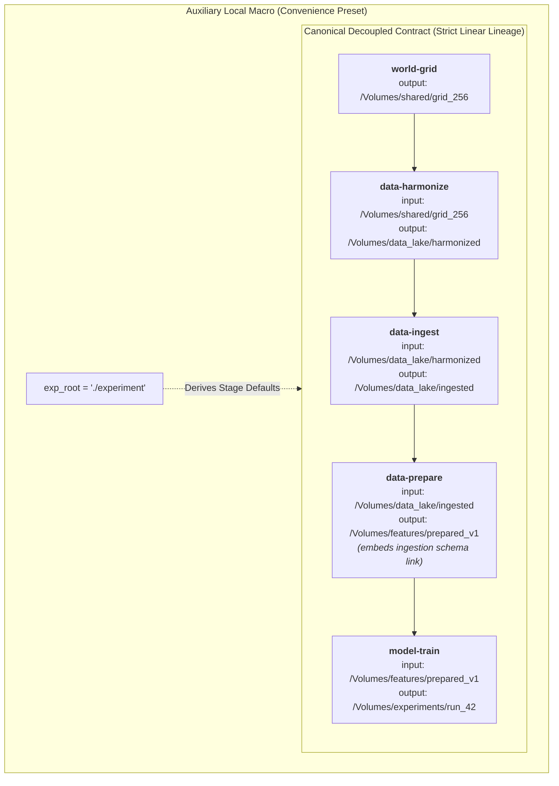

# ADR-0067: Decoupled Stage I/O and Auxiliary Experiment Root

**Status:** Accepted — Implemented<br>
**Date:** 2026-11-13<br>
**Supersedes:** [ADR-0007](ADR-0007-unified-experiment-io.md)<br>
**Related:** [ADR-0054](ADR-0054-etl-first-architecture-and-artifact-renaming.md),
[ADR-0060](ADR-0060-higher-level-workflow-orchestration-and-preflight-validation.md),
[ADR-0066](ADR-0066-production-notebook-architecture-and-databricks-integration.md)

---

## 1. Context

Early in the project's development,
[ADR-0007](ADR-0007-unified-experiment-io.md) (March 2026) mandated a unified
experiment-level I/O hierarchy organized under a single user-specified root
directory (`exp_root`):
```text
<exp_root>/
    input/                  # raw data and manifests
    artifacts/              # world grids, harmonized data, ingested blocks, prepared splits
    results/                # per-experiment checkpoints, logs, and plots
```

This single-root design was well-suited for localized workstation
experimentation where a developer ran all stages sequentially on a single disk
and wished to archive or delete a self-contained directory tree.

### 1.1. Emerging Mismatch with Decoupled Cloud Workflows

As the library evolved into an enterprise-grade framework supporting both CLI
automation and Databricks cloud clusters
([ADR-0066](ADR-0066-production-notebook-architecture-and-databricks-integration.md)),
the assumption that all pipeline stages share a single filesystem parent
directory created fundamental architectural friction:

1. **Distributed Cloud Storage & Multi-Catalog Topologies**:
   - In production cloud environments (e.g., Databricks Unity Catalog
     Volumes, AWS S3, Azure ADLS Gen2), storage paths are segmented by
     governance domain, life cycle, and access permissions.
   - Spatial reference grids are static, long-lived infrastructure assets
     shared enterprise-wide (e.g.,
     `/Volumes/shared_catalog/spatial/world_grid_256/`).
   - Harmonized imagery and ingested block pools are maintained by automated
     data engineering pipelines in shared feature store volumes (e.g.,
     `/Volumes/lakehouse/feature_store/ingested/`).
   - Model training runs and hyperparameter sweeps are ephemeral, user-
     scoped executions writing to isolated experiment directories (e.g.,
     `/Volumes/team_catalog/experiments/run_42/`).
   - Forcing every stage to live under a single parent directory violates
     cloud governance and prevents pipelines from consuming pre-existing,
     shared data assets.

2. **Artificial Path Heuristics and Leaky Abstractions**:
   - Because the core execution engine still treats `exp_root` as mandatory,
     `BaseConfigurator` had to implement fallback heuristics (such as
     setting `exp_root = str(output_dpath.parent)`), artificially guessing
     an experiment root that does not exist in decoupled cloud environments.
   - Core Hydra templates (`src/landseg/configs/hydra/`) still define stage
     paths using string interpolations against `${execution.exp_root}`
     (e.g., `output_dpath:
     ${execution.exp_root}/artifacts/harmonized_data`), creating brittle
     coupling during standalone stage execution.
   - Diagnostic tools and preflight engines continue to traverse
     `config.execution.exp_root` rather than querying stage-specific target
     directories.

3. **Foundation Established in ADR-0066 Phase 4**:
   - Phase 4 of ADR-0066 established decoupled destination (`output_dpath`)
     and upstream (`upstream_dpath`) paths across all `landseg.adapters.api`
     configurators.
   - To eliminate structural debt across the entire framework, the project
     must now formalize this transition across configuration schemas,
     artifact paths, CLI commands, and execution workflows.

### 1.2. The "Ghost" Ingestion Dependency and Recipe Disconnect

A related architectural friction exists in the runtime dataset assembly.
Currently, `geopipe.build_dataspec` (`src/landseg/geopipe/factory.py`) bridges
dataset artifacts to the PyTorch training runtime by reading from two
distinct upstream stages simultaneously:
1. Ingestion schema: `artifact_paths.data_ingestion.data_blocks.schema`
2. Preparation schema: `artifact_paths.data_preparation.schema`

Remarkably, user-facing training configuration recipes
(`configs/model_train.yaml`, `configs/study_sweep.yaml`, and
`configs/model_evaluate.yaml`) **do not configure an ingestion path at all**.
They only define `data.preparation.output_dpath` and `session.output_dpath`:
```yaml
data:
  preparation:
    output_dpath: ./experiment/artifacts/prepared_data

session:
  output_dpath: ./experiment/results
```
Similarly, the preflight validation catalog
(`src/landseg/execution/preflight/catalog.py`) for `model-train` inspects only
`data_preparation.report` and `prepared_blocks_state`, completely omitting
any checks on `data_ingestion`.

The reason training worked previously was entirely due to an **implicit
assumption powered by Hydra string interpolation**:
1. When `configs/model_train.yaml` is loaded, unconfigured schema fields retain
   their defaults from `RootConfig`.
2. In `src/landseg/configs/schema/data/ingestion.py`, `output_dpath`
   defaults to:
   `output_dpath: str = '${execution.exp_root}/artifacts/ingested_data'`
3. In `src/landseg/configs/schema/root.py`, `execution.exp_root` defaults to
   `'./experiment'`.
4. `ModelTraining` creates `ArtifactPaths.from_config(self.config)`, which
   silently resolves `data_ingestion` to `./experiment/artifacts/ingested_data`.
5. `build_dataspec` then quietly reaches into this implicit path to fetch
   `data_blocks.schema`.

This creates a hidden "ghost" dependency. As soon as a user runs in a
decoupled or cloud environment (e.g., Databricks Unity Catalog Volumes where
prepared data lives at `/Volumes/lakehouse/features/prepared_v1/` and training
runs write to `/Volumes/team/experiments/run_42/`), this interpolation fails:
`build_dataspec` continues searching for
`${execution.exp_root}/artifacts/ingested_data/schema.json` and crashes with
a `FileNotFoundError`.

Forcing users to add `data.ingestion.output_dpath` to `configs/model_train.yaml`
would be an architectural regression: it would pollute model training
recipes with earlier ETL pipeline stages that training should never manage.

---

## 2. Decision

We have formally **superseded ADR-0007**. We established **Explicit
Decoupled Stage I/O** as the primary, first-class contract across the entire
codebase, enforce **strictly single upstream dependencies** between stages,
and demoted `exp_root` to an **optional auxiliary convenience macro**.



The architecture is structured around five core pillars:
1. Pure Decoupled Stage Contracts
2. Single Upstream Lineage for Model Training (Ingestion Schema Forwarding)
3. Optional `exp_root` in Configuration Schemas
4. Autonomous Stage `ArtifactPaths` Namespaces
5. Auxiliary Layout Presets for Local Workstation Development

---

### 2.1. Pure Decoupled Stage Contracts

Every pipeline command and configurator operates strictly on explicit
input source paths and explicit output destination paths:

| Stage Command | Direct Upstream Inputs | Destination Output (`output_dpath`) |
| :--- | :--- | :--- |
| `world-grid` | Reference raster (`ref_fpath`) or manual bounding box | World grid definition directory (`output_dpath`) |
| `data-harmonize` | Raw manifest (`dataset_manifest`), grid directory (`grid_dpath`) | Harmonized virtual rasters (`output_dpath`) |
| `data-ingest` | Harmonization directory (`harmonization_dpath`) | Sliced data block pool (`output_dpath`) |
| `data-prepare` | Ingestion block pool (`ingestion_dpath`) | Normalized, split dataset (`output_dpath`) |
| `model-train` | Prepared dataset (`preparation_dpath`) | Run results, logs, and checkpoints (`output_dpath`) |
| `study-sweep` | Prepared dataset (`preparation_dpath`), Optuna storage backend | Sweep trial records and Pareto checkpoints (`output_dpath`) |

Each stage in the primary training path has exactly **one upstream data
input**. Configurators and CLI entrypoints no longer require or assume
that these paths reside in the same directory branch.

---

### 2.2. Single Upstream Lineage for Model Training (Schema Forwarding)

To eliminate the dual-upstream dependency in `model-train` and `study-sweep`,
the data preparation stage records upstream provenance directly inside
the preparation schema and execution report:

1. **`PreparedSchema` Upstream Provenance**:
   During `data-prepare` (`src/landseg/geopipe/prepare/materialize/schema.py`),
   the preparation runner resolves and validates the ingestion schema.
   When materializing `PreparedSchema`, the builder records the resolved
   ingestion schema artifact path and its SHA-256 checksum in `PreparedSchema`:
   ```python
   collected_artifacts = {
       'ingestion_schema': str(context.ingestion_schema_fpath.resolve()),
       'block_source': str(paths.splits_source_blocks.resolve()),
       'block_prepared': str(paths.splits_prepared_blocks.resolve()),
       'label_stats': str(paths.label_stats.resolve()),
       'image_stats': str(paths.image_stats.resolve()),
   }
   ```
   The preparation summary report (`contracts.SchemaReport`) similarly
   records `ingestion_schema_filepath` for operational diagnostics.

2. **Self-Contained DataSpecs Assembly**:
   We refactored `build_dataspec` (`src/landseg/geopipe/factory.py`) so that
   its primary input contract is strictly `preparation_dpath` (or `PreparationPaths`).
   When assembling `DataSpecs`:
   - It fetches `PreparedSchema` from `preparation_dpath`.
   - It resolves `data_schema_fpath` directly from
     `prepared_schema['artifacts']['ingestion_schema']`.
   - Domain tilemaps (`ids_domain_name`, `vec_domain_name`) resolve
     relative to the ingestion schema location or embedded domain links.
   - It operates with zero runtime dependency on `data_ingestion` arguments.

3. **Single-Upstream Training Configurators**:
   `TrainingSessionConfigurator` and `StudySweepConfigurator` require
   strictly `preparation_dpath` (or `upstream_dpath`) and `output_dpath`.
   The `ingestion_dpath` parameter was removed from `build_dataspec` and
   `TrainingSessionConfigurator`. This ensures downstream training jobs track
   a single upstream data asset.

4. **Preserving Clean Recipe Ergonomics (`model_train.yaml`)**:
   `configs/model_train.yaml`, `configs/study_sweep.yaml`, and
   `configs/model_evaluate.yaml` remain entirely free of `data.ingestion`.
   They declare only `data.preparation.output_dpath` and `session.output_dpath`,
   aligning runtime execution with user recipes and preflight contracts.

---

### 2.3. Configuration Schema Decoupling (`RootConfig`)

1. **Made `exp_root` Optional**:
   `RootConfig.execution.exp_root` was updated to:
   ```python
   exp_root: str | None = None
   ```
2. **Removed Hardcoded String Interpolations from Hydra Templates**:
   Default YAML recipes (`src/landseg/configs/hydra/`) define autonomous
   stage defaults rather than relying on `${execution.exp_root}`.
   For example, `src/landseg/configs/hydra/data/harmonization/default.yaml`
   became:
   ```yaml
   output_dpath: ./artifacts/harmonized_data
   ```
   instead of:
   ```yaml
   output_dpath: ${execution.exp_root}/artifacts/harmonized_data
   ```
3. **Strict Path Validation**:
   When a stage executes, its respective section validator verifies only
   its declared upstream and output paths. Unrelated stages do not validate
   or create unneeded directory trees.

---

### 2.4. Autonomous Stage `ArtifactPaths` Namespaces

`src/landseg/artifacts/paths/` was refactored so each stage's path helper
can be instantiated directly and independently:

```python
# Direct instantiation of session paths without parent root requirement
paths = SessionPaths(root=pathlib.Path('/Volumes/experiments/run_42'))
checkpoint_path = paths.best_checkpoint('baseline')
```

`ArtifactPaths` remains as a top-level aggregation facade, but each
property (`world_grid`, `data_harmonization`, `data_ingestion`,
`data_preparation`, `session`) operates strictly on its explicit directory
root without falling back to a shared parent unless explicitly requested.

---

### 2.5. Auxiliary Layout Presets for Local Development

To preserve a seamless developer experience on single-directory local
workstations, we provided auxiliary layout macros:

1. **Programmatic Factory**:
   ```python
   # Convenience factory populating canonical convention
   configurator = api.TrainingSessionConfigurator.from_experiment_root(
       './experiment'
   )
   ```
   This helper cleanly derives:
   - `preparation_dpath = './experiment/artifacts/prepared_data'`
   - `output_dpath = './experiment/results'`
2. **Default Recipe Relative Paths**:
   Default Hydra recipe templates specify canonical relative paths
   (e.g., `./experiment/artifacts/prepared_data` and
   `./experiment/results`), allowing users to execute local end-to-end
   experiments out of the box without requiring extra configuration flags
   or preset overrides.

---

## 3. Consequences

### 3.1. Positive Consequences
- **Strict Linear Pipeline Lineage**: `model-train` and `study-sweep` depend
  solely on `data-prepare` (`preparation_dpath`). Lineage back to ingestion
  is preserved deterministically via `PreparedSchema['artifacts']` without
  requiring orchestrator DAGs to wire multiple upstream handles.
- **Cloud & Enterprise Alignment**: Databricks Unity Catalog Volumes, shared
  lakehouse feature stores, and S3 buckets become native first-class targets
  without path hacking.
- **Composable Pipelines**: Stages can execute independently in distributed
  orchestrators (Databricks Workflows, Airflow, Prefect, Kubeflow) across
  separate compute nodes and distinct storage volumes.
- **Elimination of Path Workarounds**: Removes synthetic parent directory
  resolution (`output_dpath.parent`) and eliminates ambiguous directory
  crawling in telemetry and preflight checks.
- **Shared Infrastructure Assets**: Teams can reuse pre-generated world
  grids and ingested block pools across dozens of training experiments
  without data duplication.

### 3.2. Trade-offs and Mitigations
- **Multiple CLI Path Arguments**:
  - *Trade-off*: Running individual stages without a unified root requires
    specifying upstream inputs and downstream outputs.
  - *Mitigation*: Sensible default relative paths and programmatic
    `from_experiment_root(...)` macros maintain single-parameter
    execution for local research.
- **Schema Reference Portability**:
  - *Trade-off*: If an ingestion directory is physically relocated after data
    preparation, the absolute path recorded in
    `PreparedSchema['artifacts']['ingestion_schema']` may become stale.
  - *Mitigation*: `build_dataspec` supports resolving ingestion schema either
    via the absolute path recorded at preparation time or relative to the
    preparation directory (`ingestion_schema_relpath`) when both live in a
    portable bundle.
- **Migration of Existing Custom Configs**:
  - *Trade-off*: Custom Hydra YAML files that strictly relied on overriding
    `execution.exp_root` will need to specify stage-specific paths.
  - *Mitigation*: Backward-compatible resolution in `BaseConfigurator` will
    continue to populate stage defaults if `experiment_root` is explicitly
    passed.

---

## 4. Implementation Status

The implementation has been fully completed across four phases:

### Phase 1: Lineage Forwarding & Schema Primitives
- Updated `src/landseg/geopipe/core/prepared_schema.py` and
  `src/landseg/geopipe/prepare/materialize/schema.py` to record
  `ingestion_schema` path and checksum in `PreparedSchema`.
- Updated `src/landseg/geopipe/factory.py` (`build_dataspec`) to dynamically
  resolve `data_schema_fpath` from
  `prepared_schema['artifacts']['ingestion_schema']` and
  `ingestion_schema_relpath`, with zero runtime coupling to `data_ingestion`.
- Updated `TrainingSessionConfigurator` in
  `src/landseg/adapters/api/configurators/model_train.py` to make
  `preparation_dpath` the sole upstream dependency, eliminating redundant
  `upstream_dpath` and `ingestion_dpath` parameters.
- Updated `src/landseg/configs/schema/root.py` and `execution.py` to make
  `exp_root` optional (`str | None = None`).
- Refactored `src/landseg/artifacts/paths/root.py` and sub-modules to allow
  autonomous instantiation of stage paths without requiring a shared parent
  `root`.
- Updated Hydra default configuration files to remove `${execution.exp_root}`
  string interpolations.

### Phase 2: Workflows & Preflight Decoupling
- Updated preflight validation catalog (`src/landseg/execution/preflight/`)
  and `pool_compatibility` check to validate stage-specific inputs and outputs
  directly without requiring `world_grid` or `execution.exp_root`.
- Updated diagnostic workflows (`diagnose_overfit`, `study_analysis`) to
  consume stage-specific paths.
- Removed synthetic `output_dpath.parent` fallback logic from
  `BaseConfigurator`.

### Phase 3: Auxiliary Convenience Helpers & MLOps Decoupling
- Introduced `Configurator.from_experiment_root(...)` factory methods across
  all stage configurators.
- Updated `src/landseg/mlops/storage.py` (`sync_optuna_study`) and
  `registry.py` (`register_unity_catalog_model`) to accept decoupled target
  paths directly (`output_dpath`, `session_dpath`).

### Phase 4: Validation & Documentation
- Authored comprehensive unit tests covering standalone decoupled execution,
  single-upstream training resolution, preflight gating, MLOps storage/registry,
  and auxiliary macro factories.
- Validated test suite across all affected modules.
