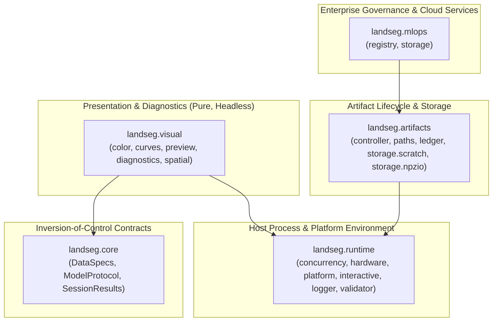
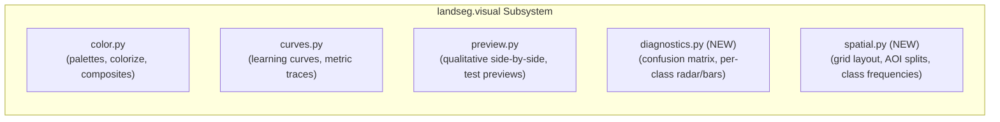

# ADR-0069: Decoupled Visual Diagnostics, Interactive Runtime Safety, and Subsystem Streamlining

**Status:** Proposed 
**Date:** 2026-11-24 
**Branch:** `visualization` 
**Related:**
[ADR-0066](ADR-0066-production-notebook-architecture-and-databricks-integration.md),
[ADR-0067](ADR-0067-decoupled-stage-io-and-auxiliary-experiment-root.md),
[ADR-0068](ADR-0068-cloud-raster-io-and-execution-hardening.md) 
**Issues:** #93, #94

---

## 1. Context & Problem Statement

As the `landseg` framework progressed through decoupled stage I/O
([ADR-0067](ADR-0067-decoupled-stage-io-and-auxiliary-experiment-root.md)),
production Databricks notebook execution
([ADR-0066](ADR-0066-production-notebook-architecture-and-databricks-integration.md)),
and cloud raster materialization
([ADR-0068](ADR-0068-cloud-raster-io-and-execution-hardening.md)),
the core geospatial pipeline, model architecture, and runtime execution
reached enterprise-grade determinism.

However, as deployment broadened across headless pipelines, multi-trial
sweeps, and interactive notebooks, three architectural entanglements became
apparent:

### 1.1. Visual Presentation Entanglement

Visual presentation (loss/metric curves, qualitative segmentation previews,
error highlights, and palette colorization) was historically fragmented:
* Prediction previews and palette colorization were buried inside
  `landseg.session.instrumentation.formatters.renderer` and tightly coupled to
  internal training loop event callbacks.
* Post-training curves and qualitative inspection relied on ad-hoc,
  unstandardized plotting code copy-pasted across notebook cells.
* Non-training pipelines—such as model evaluation (`model_evaluate`) and
  geospatial preparation stages (`world_grid`, `data_prepare`)—lacked
  standardized, automated visual artifact outputs (e.g., confusion matrices,
  class frequency audits, AOI partition footprints).

### 1.2. The Notebooks Namespace Conflation

The legacy `landseg.notebooks` package blurred the boundary between **host
process execution safety** and **visual presentation**:
* `NotebookWidgets` and `require_widget` managed UI parameter inputs.
* `safe_training_session` managed `KeyboardInterrupt` interception, PyTorch
  CUDA memory reclamation, and MLflow run state.
* Meanwhile, metric plotting functions resided in the same namespace.

This violated the Single Responsibility Principle: a headless library should
not maintain a dedicated top-level "notebooks" package when notebook
parameterization and interrupt safety are host runtime concerns, while
plotting is a pure presentation concern.

### 1.3. Subsystem Namespace Sprawl & Legacy Residue

Auditing first-class top-level packages under `src/landseg/` revealed
structural bloat and boundary leaks:
1. **Generic Dumping Ground (`landseg.utils`)**:
   After device detection, multiprocessing, and logging were migrated to
   `landseg.runtime` in ADR-0068, `landseg.utils` was left with only two
   heterogeneous files: `validator.py` (parameter checking) and `npzio.py`
   (sequential archive persistence). It functioned as an ambiguous
   catch-all package.
2. **Ghost Directories**:
   Stale, empty directories containing untracked `__pycache__` residue
   (`src/landseg/cli/`, `src/landseg/controller/`, `src/landseg/notebooks/`)
   lingered in local workspaces following previous module migrations.
3. **MLOps Boundary Leakage**:
   `landseg.mlops` re-exported platform probes (`is_databricks`,
   `get_cluster_id`, `get_runtime_version`, `get_git_commit`, `get_dbutils`),
   blurring the line between local compute runtime and remote enterprise
   governance.

---

## 2. Governing Architectural Principles

To resolve these entanglements, this ADR establishes four governing design
invariants:

### Invariant 1: Visualization as a Pure, Headless Diagnostic Subsystem
Visualization must be an independent, first-class subsystem (`landseg.visual`)
free of notebook dependencies, training loop side effects, and GUI blocking.
It must operate headlessly via Matplotlib's `Agg` backend, emitting structured
figure objects and persisting publication-ready PNG/SVG artifacts directly
into `pipeline_paths.plots`.

### Invariant 2: Host Process Safety Belongs Strictly to `landseg.runtime`
Interactive parameter widgets (`NotebookWidgets`, `require_widget`) and
execution process safety (`safe_training_session`) are host-environment
facilities. They belong inside `landseg.runtime.interactive`, sitting
alongside `runtime.platform` and `runtime.hardware`.

### Invariant 3: Elimination of Generic Miscellaneous Packages
No top-level module may serve as an untyped catch-all. Every shared utility
must belong to its specific architectural owner:
* Validation primitives belong in `landseg.runtime.validator`.
* Sequential storage serialization belongs in `landseg.artifacts.storage.npzio`.
* `landseg.utils` is decommissioned entirely.

### Invariant 4: Sharply Bounded Contexts for Specialized Modules
* `landseg.core`: Retained as the minimal, dependency-free interface boundary
  (`DataSpecs`, `ModelProtocol`, `SessionResults`) to prevent circular imports
  across geopipe, models, and session.
* `landseg.mlops`: Strictly bounded to remote enterprise services (Unity
  Catalog Model Registry, Volume storage resolution, Optuna remote sync).
* `landseg.testing`: Retained as a developer fixture toolkit for generating
  canonical synthetic GeoTIFFs across test harnesses and smoke notebooks.

---

## 3. Completed Foundations (Existing Commits)

The initial implementation on the `visualization` branch established the core
separation of concerns:

### 3.1. Extraction of `landseg.visual` (Commit `bc1d425`)
* Introduced `landseg.visual` as a first-class subsystem owning:
  * `color.py`: Palette mapping and integer-to-RGB tensor colorization.
  * `curves.py`: Multi-head training and validation loss/metric curves.
  * `preview.py`: Side-by-side qualitative prediction panels and automated
    test block inference preview generation.
* Decoupled `session.instrumentation` by deleting legacy `formatters/renderer.py`
  and routing inference tracking callbacks directly through `visual.colorize`.
* Wired post-training curve plotting and test preview generation into
  `ModelTraining._generate_post_run_visuals()`.

### 3.2. Decommissioning `landseg.notebooks` (Commit `fb869f6`)
* Relocated `safe_training_session` into the `landseg.runtime` namespace.
* Updated call sites across `notebooks/02_model_train.ipynb` and pipeline
  runners to import from `landseg.visual` and `landseg.runtime`.
* Decommissioned `src/landseg/notebooks/`.

### 3.3. Runtime Consolidation & Test Suite Realignment (Commit `a6074d6`)
* Moved `safe_training_session` into `landseg.runtime.interactive`, removing
  implicit MLflow tracking dependencies to maintain pure process safety.
* Cleaned up re-exports from `landseg.mlops.__init__`, enforcing that platform
  probes (`is_databricks`, `get_cluster_id`) are consumed via `runtime`.
* Relocated and restructured test suites:
  * Relocated platform environment tests to `tests/unit/runtime/test_platform.py`.
  * Consolidated widget and session safety tests to
    `tests/unit/runtime/test_interactive.py`.
  * Pruned obsolete `tests/unit/mlops/test_env.py` and `tests/unit/notebooks/`.

---

## 4. Proposed Structural Decisions & Roadmap

The remaining scope consolidates first-class module boundaries and expands
`landseg.visual` into a comprehensive evaluation and geospatial diagnostic
suite.

### Phase 1: Ghost Directory & Legacy Cleanup
* Permanently remove empty ghost directories (`src/landseg/cli/`,
  `src/landseg/controller/`, `src/landseg/notebooks/`) from local developer
  environments and update `.gitignore` / clean scripts to prevent lingering
  `__pycache__` regeneration.

### Phase 2: Top-Level Module Consolidation (`landseg.utils` Decommissioning)
* **Relocate `npzio.py`**:
  * Move `src/landseg/utils/npzio.py` $\rightarrow$
    `src/landseg/artifacts/storage/npzio.py`.
  * Re-export from `landseg.artifacts.storage`.
  * Update internal call sites in `geopipe.core.data_block`,
    `geopipe.prepare.materialize`, and `artifacts.controller`.
* **Relocate `validator.py`**:
  * Move `src/landseg/utils/validator.py` $\rightarrow$
    `src/landseg/runtime/validator.py`.
  * Re-export from `landseg.runtime`.
  * Update call sites across configs, geopipe, session, and pipelines.
* **Decommission `landseg.utils`**:
  * Delete `src/landseg/utils/`.
  * Relocate `tests/unit/utils/test_npzio.py` $\rightarrow$
    `tests/unit/artifacts/storage/test_npzio.py`.
  * Relocate `tests/unit/utils/test_validator.py` $\rightarrow$
    `tests/unit/runtime/test_validator.py`.

### Phase 3: Visual Diagnostic Suite Expansion (`landseg.visual`)

1. **Evaluation Diagnostics (`landseg.visual.diagnostics`)**:
   * Add `plot_confusion_matrix(cm, class_names=None, normalize=True, save_path=None)`:
     Render row/column normalized confusion matrix heatmaps with annotations.
   * Add `plot_per_class_metrics(metrics, class_names=None, save_path=None)`:
     Bar and radar charts highlighting per-class Intersection over Union (IoU)
     and F1 performance across multi-class heads.
   * Integrate evaluation visuals into `ModelEvaluation` pipeline
     (`src/landseg/execution/pipelines/model_evaluate.py`), persisting
     confusion matrices and metric summaries to `pipeline_paths.plots`.
2. **Geospatial & Stage-Zero Audits (`landseg.visual.spatial`)**:
   * Add `plot_grid_layout(grid_layout, aoi_splits=None, save_path=None)`:
     Visualize tiling origins, bounding extents, and geographic train/val/test
     AOI split polygons over regional basemaps.
   * Add `plot_class_frequencies(dataspecs, save_path=None)`:
     Generate class distribution histograms from Welford partition statistics
     to audit rare vegetation classes prior to compute allocation.
   * Add `plot_spectral_composite(raster_array, bands=(3, 2, 1), save_path=None)`:
     Support true-color RGB and false-color infrared (NIR-Red-Green)
     visualizations for raw raster inputs.
3. **Canonical Palettes & Diverging Colormaps (`landseg.visual.color`)**:
   * Standardize error palettes: export `DEFAULT_ERROR_PALETTE` and
     `DEFAULT_MATCH_PALETTE` constants, eliminating duplicate ad-hoc dicts.
   * Introduce canonical forestry / FRI species palettes and NLCD landcover
     palettes.
   * Support continuous diverging colormaps (Viridis, Turbo, RdYlGn) for
     auxiliary regression heads (canopy height, biomass, crown density).
4. **Performance & Memory Hardening**:
   * Implement windowed overview downsampling in `preview.py` to prevent host
     OOM when stitching massive contiguous test mosaics ($10k \times 10k+$ px).
   * Enforce explicit `matplotlib.pyplot.close(fig)` across all generators to
     prevent figure memory leaks during long multi-epoch runs and study sweeps.

### Phase 4: Documentation Synchronization
* Update `docs/ARCHITECTURE.md` and `docs/project_structure.md` to:
  * Reflect the decommissioned `landseg.notebooks` and `landseg.utils` modules.
  * Document `landseg.visual` as the primary presentation layer.
  * Clarify the boundary between `landseg.runtime` and `landseg.mlops`.

---

## 5. First-Class Module Roster & Decision Matrix

| Subsystem | Files | LoC | Architectural Responsibility | Decision |
| :--- | :---: | :---: | :--- | :--- |
| `adapters` | 14 | 1,309 | CLI recipes & API configurators | **Retain as first-class** |
| `artifacts` | 16 | 2,006 | Central persistence, policy, ledgers, scratch storage | **Retain as first-class** (absorbs `npzio`) |
| `configs` | 29 | 1,869 | Typed dataclass schemas & Hydra trees | **Retain as first-class** |
| `core` | 4 | 681 | `DataSpecs`, `ModelProtocol`, `SessionResults` | **Retain as first-class** (Inversion of Control) |
| `execution` | 32 | 3,927 | Pipelines, workflows, preflight, unified dispatcher | **Retain as first-class** |
| `geopipe` | 84 | 13,275 | Rasters, grid, harmonization, ingestion, preparation | **Retain as first-class** |
| `knowledge` | 4 | 425 | FRI taxonomies, species profiles, embeddings | **Retain as first-class** (decoupled asset) |
| `mlops` | 3 | 657 | Unity Catalog model registry & volume sync | **Retain as first-class** (enterprise services) |
| `models` | 28 | 3,275 | Backbones, conditioners, heads, frames, factory | **Retain as first-class** |
| `runtime` | 6 | 1,277 | Hardware, concurrency, platform, interactive, logger | **Retain as first-class** (absorbs `validator`) |
| `session` | 77 | 9,435 | Engine, dataloaders, loss, metrics, callbacks | **Retain as first-class** |
| `study` | 16 | 1,352 | Hyperparameter sweeps, mutators, Pareto analysis | **Retain as first-class** |
| `testing` | 4 | 652 | Synthetic GeoTIFF fixtures for tests & notebooks | **Retain as first-class** (developer toolkit) |
| `visual` | 4 | 916 | Colorization, curves, previews, diagnostics, spatial | **Retain & expand** |
| `utils` | 3 | 457 | Miscellaneous validation and NPZ writing | **Decommission** |

---

## 6. Consequences & System Invariants

### Positive
* **Zero Catch-All Modules**: The elimination of `landseg.utils` ensures that
  every module in the codebase has a clear, unambiguous architectural home.
* **Deterministic, Headless Visual Diagnostics**: `landseg.visual` provides
  complete, out-of-the-box visual coverage for training, evaluation, and
  spatial preparation without coupling to notebook kernels.
* **Isolated Process Safety**: Interrupt safety and widget parameterization
  are standard runtime capabilities under `landseg.runtime.interactive`.
* **Clean Top-Level Namespace**: Pruning ghost directories and decommissioned
  packages leaves 14 highly cohesive, well-bounded top-level subsystems.
* **Single Unbroken Test Suite**: Test relocations mirror source modularity
  precisely (`tests/unit/runtime/`, `tests/unit/visual/`,
  `tests/unit/artifacts/`).

### Negative & Neutral
* **Internal Import Migrations**: Code currently importing `landseg.utils.validator`
  will migrate to `landseg.runtime.validator` (or `landseg.runtime`), and
  `landseg.utils.npzio` will migrate to `landseg.artifacts.storage.npzio`.
* **Testing Module Retained**: While `landseg.testing` could theoretically fold
  into `geopipe.synthetic`, retaining it avoids breaking external notebook
  quickstarts and integration test fixtures.
