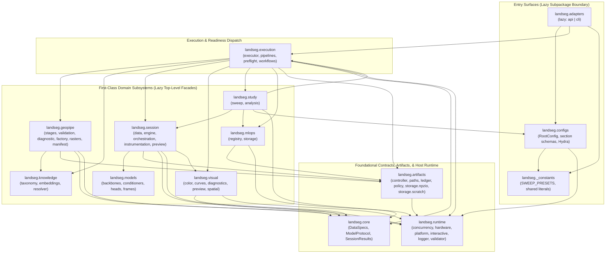

# ADR-0069: First-Class Module Boundary Hardening and Subsystem Streamlining

**Status:** Accepted — Implemented 
**Date:** 2026-11-25 
**Related:**
[ADR-0066](ADR-0066-production-notebook-architecture-and-databricks-integration.md),
[ADR-0067](ADR-0067-decoupled-stage-io-and-auxiliary-experiment-root.md),
[ADR-0068](ADR-0068-cloud-raster-io-and-execution-hardening.md) 

---

## 1. Context & Problem Statement

Following decoupled stage I/O
([ADR-0067](ADR-0067-decoupled-stage-io-and-auxiliary-experiment-root.md)),
production notebook integration
([ADR-0066](ADR-0066-production-notebook-architecture-and-databricks-integration.md)),
and cloud raster execution hardening
([ADR-0068](ADR-0068-cloud-raster-io-and-execution-hardening.md)),
`landseg` had evolved into a mature multi-stage ML and geospatial framework
spanning CLI recipes, programmatic APIs, Optuna hyperparameter sweeps, and
cloud notebooks.

A comprehensive architectural audit of the package graph under `src/landseg/`,
`scripts/`, and `notebooks/` revealed three structural weaknesses eroding
modularity, import isolation, and clear subsystem ownership:

### 1.1. Ambiguous Package Ownership & Catch-All Residue
* **`landseg.utils`** functioned as an uncohesive catch-all holding only two
  unrelated modules after ADR-0068: `npzio.py` (sequential archive persistence)
  and `validator.py` (primitive parameter validation).
* **`landseg.notebooks`** conflated host execution concerns (interactive widget
  inputs, `KeyboardInterrupt` capture, CUDA memory cleanup) with diagnostic
  plotting (`telemetry.py`), while legacy palette/preview rendering remained
  embedded inside `session/instrumentation/formatters/renderer.py`.
* **`landseg.mlops`** re-exported host environment probes (`is_databricks`,
  `get_cluster_id`, `get_runtime_version`, `get_git_commit`, `get_dbutils`),
  blurring local runtime discovery with remote enterprise governance.
* Diagnostic figure generation lacked a clear headless boundary: `visual`
  plotting and `session` runtime inference/model construction bled into one
  another, and evaluation/spatial stages lacked standardized visual artifacts.

### 1.2. Cross-Subsystem Deep Imports & Leaky Facades
Static AST inspection across the repository identified widespread bypassing of
top-level package boundaries:
* `execution/pipelines/`, `execution/preflight/checks/contracts.py`,
  `execution/workflows/` (`batch_ingest`, `diagnose_overfit`), Stage-0 scripts,
  and `00_*` notebooks reached directly into internal `geopipe.core`,
  `geopipe.grid`, `geopipe.harmonize.*`, `geopipe.ingest.*`,
  `geopipe.prepare.*`, and `geopipe.rasters` submodules.
* `BasePipeline` required geospatial stage pipelines to know and instantiate
  internal `geopipe` `*Logger`, `*Context`, and `build_*_context` primitives
  directly; preflight contract probes likewise reconstructed `IngestionContext`
  and read internal dataset schemas.
* Many top-level packages lacked consistent lazy `__getattr__` public facades,
  encouraging internal cross-subsystem imports to target deep files directly.

### 1.3. Bidirectional Cycles & Heavy Transitive Coupling
* **Circular `geopipe` ↔ `knowledge` dependency & duplicated orchestration**:
  `knowledge.taxonomy` imported `TaxonomySpec` from `geopipe.core`, while
  `geopipe.factory` imported `knowledge`, and `execution/workflows/diagnose_overfit.py`
  duplicated taxonomy/similarity resolution logic alongside inline `.npz`
  diagnostic block assembly.
* **Transitive `study`/`optuna` leakage into `configs` & `adapters`**: Validating
  sweep preset names imported `landseg.study.sweep.presets` inside API
  configurators and config validation paths.
* **Eager `cli` coupling in `landseg.adapters`**: Importing `landseg.adapters`
  eagerly pulled in Hydra CLI modules even for lightweight programmatic
  notebook API callers.

---

## 2. Governing Architectural Principles & Topology

To transform every top-level package into a strictly bounded, cohesive
first-class subsystem, this ADR establishes five architectural invariants:

### Invariant 1: Cohesive, Catch-All-Free First-Class Subsystems
Every top-level package owns a single, unambiguous architectural responsibility.
Residual catch-all packages (`landseg.utils`) and environment-named packages
(`landseg.notebooks`) are decommissioned permanently, with every capability
re-homed to its natural owner (`runtime`, `artifacts.storage`, `visual`).

### Invariant 2: Top-Level Lazy Facades as the Exclusive Inter-Subsystem Boundary
Cross-subsystem callers inside `src/landseg/`, `scripts/`, and `notebooks/`
import only top-level `landseg.<subsystem>` namespaces (implemented via
`__getattr__` + `if typing.TYPE_CHECKING:` blocks), never deep internal
submodules.
* **Explicit architectural exception**: `landseg.runtime.validator` is permitted
  as a zero-dependency leaf primitive import inside schema/manifest/builder
  modules (`7` internal leaf import sites).

### Invariant 3: Encapsulated Domain Orchestration & Validation Contracts
Subsystems hide internal loggers, contexts, and builders behind domain-owned
facades. `execution/` dispatches lifecycle runs, preflight checks, and
workflows without assembling internal `geopipe` state or schemas directly.

### Invariant 4: Acyclic Layering & Lightweight Entry Surfaces
* `landseg.core` acts as the dependency-free inversion-of-control contract
  layer (`DataSpecs`, `ModelProtocol`, `SessionResults`).
* `landseg.knowledge` owns `TaxonomySpec` and taxonomy/similarity resolution,
  keeping `geopipe` ↔ `knowledge` strictly one-way (`geopipe` → `knowledge`).
* Shared literals (`SWEEP_PRESETS` in `_constants.py`) isolate `configs` and
  `adapters` from `study`/`optuna`, and `landseg.adapters` lazily resolves `api`
  vs `cli` so callers pay no unnecessary import cost.

### Invariant 5: Strict Separation of Runtime Computation from Pure Presentation
Headless figure rendering (`landseg.visual`, Matplotlib `Agg`) never constructs
models, builds dataloaders, reads config schemas, or drives inference loops.
Preview inference orchestration lives inside `landseg.session`, passing prepared
`core` contracts and artifact paths outward to presentation utilities.

---

## 3. Architectural Restructuring Implemented (Full Diff vs. `main`)

Measured against `origin/main` (b8db1f87f891b5b9cb7f855eead3d07ee9746199), the
implementation refactored **112 files (+7,222 / -2,610)** across five coordinated areas:

### 3.1. Namespace Consolidation & Package Decommissioning
* **Decommissioned `landseg.utils`**:
  * Relocated `npzio.py` → `landseg.artifacts.storage.npzio`, re-exported via
    `landseg.artifacts` and `landseg.artifacts.storage`.
  * Relocated `validator.py` → `landseg.runtime.validator`, re-exported via
    `landseg.runtime`.
  * Updated all import sites across `artifacts`, `configs`, `geopipe`,
    `adapters`, and notebooks; relocated tests to `tests/unit/artifacts/storage/test_npzio.py`
    and `tests/unit/runtime/test_validator.py`; removed `src/landseg/utils/`.
* **Decommissioned `landseg.notebooks`**:
  * Moved `NotebookWidgets`, `require_widget`, `MissingRequiredInputError`, and
    `safe_training_session` (stripped of implicit MLflow dependencies) into
    `landseg.runtime.interactive`, exposed via `landseg.runtime`.
  * Updated notebooks `00_*`–`03_*`, relocated runtime tests to
    `tests/unit/runtime/test_interactive.py` and `tests/unit/runtime/test_platform.py`,
    and removed `src/landseg/notebooks/` and `tests/unit/notebooks/`.
* **Bounded `landseg.mlops`**: Removed re-exported platform environment probes
  from `mlops.__init__`, routing all runtime environment inspection strictly
  through `landseg.runtime` while retaining `mlops.registry` and `mlops.storage`.

### 3.2. Standardized Lazy Top-Level Package Facades
* Implemented consistent lazy `__getattr__` + `TYPE_CHECKING` public facades
  across top-level packages (`adapters`, `configs`, `configs.schema`,
  `execution`, `execution.preflight`, `geopipe`, `knowledge`, `runtime`,
  `session`, and `visual`).
* Tightened return/input contracts and eliminated redundant catch-all exception
  blocks across execution pipelines (`model_train.py`, `model_evaluate.py`)
  and presentation helpers.

### 3.3. `geopipe` Facade Encapsulation & `execution` Decoupling
* **Contract validation facade (`src/landseg/geopipe/validation.py`)**:
  * Added plain-data validation wrappers (`validate_grid_specs`,
    `validate_grid_reference`, `validate_manifest_contract`,
    `validate_pool_compatibility`, `validate_feature_specs`,
    `validate_raster_alignment`, `validate_prepare_semantics`) lazily exported
    from `landseg.geopipe`.
  * Refactored `execution/preflight/checks/contracts.py` to import exclusively
    from top-level `landseg.geopipe`, removing all `6` deep `geopipe.*`
    imports, `IngestionContext` construction, and direct schema reads.
* **Public stage execution facade (`src/landseg/geopipe/stages.py`)**:
  * Added `run_world_grid_stage`, `run_data_harmonization_stage`,
    `run_data_ingestion_stage`, and `run_data_preparation_stage` (encapsulating
    stage `*Logger` creation, `build_*_context`, stage execution, and
    runs-manifest updates), lazily exported alongside
    `resolve_pending_ingestion_batches` via `landseg.geopipe`.
  * Simplified `BasePipeline` (`execution/pipelines/base.py`) by removing
    abstract `_create_logger` / `_build_context` requirements (retaining
    `_create_logger` on `SessionPipeline._initialize_run()`), decoupling
    `world_grid.py`, `data_harmonize.py`, `data_ingest.py`, `data_prepare.py`,
    and `execution/workflows/batch_ingest.py` from all `geopipe.*` internals.
* **Diagnostic DataSpecs builder (`src/landseg/geopipe/diagnostic.py`)**:
  * Extracted `build_overfit_dataspec` (cached `.npz` reuse, diagnostic block
    assembly/normalization, head knowledge wiring) into `geopipe` and exported
    it lazily from `landseg.geopipe`.
  * Reduced `execution/workflows/diagnose_overfit.py` to pure session and
    model orchestration with zero `geopipe.*`, `knowledge`, `numpy`, or `torch`
    imports.
* **Stage-0 consumer alignment**: Exported `DatasetManifestBuilder`,
  `SensorPreset`, and `build_vrt_mosaic` on `landseg.geopipe` and updated
  `scripts/build_raster_mosaic.py`, `notebooks/00_raster_mosaic.ipynb`, and
  `notebooks/00_dataset_manifest.ipynb` to import solely from top-level
  `landseg.geopipe`.

### 3.4. Acyclic `knowledge`, `configs`, `adapters`, & `study` Boundaries
* **Broke `geopipe` ↔ `knowledge` cycle & deduplicated resolution**:
  * Relocated `TaxonomySpec` from `geopipe.core` into `knowledge.taxonomy` and
    updated `data_block.py`, `data_schema.py`, and `label_scheme.py`.
  * Extracted shared `resolve_head_knowledge()` in `knowledge/resolver.py`
    (lazily exported by `landseg.knowledge`) for reuse across
    `geopipe.factory` and `geopipe.diagnostic`.
* **Decoupled `adapters` & `configs` from `study`**:
  * Added `SWEEP_PRESETS` (`18` presets matching `study.sweep.presets`) in
    `src/landseg/_constants.py`.
  * Enforced membership validation in `StudySweepConfig.validate()`,
    `StudySweepConfigurator`, and `BaseConfigurator.running_root_config`
    (covering both `study-sweep` and `study-analysis`) without importing
    `landseg.study` or `optuna`.
* **Lazy `adapters` subpackage split**: Converted `src/landseg/adapters/__init__.py`
  to lazy `__getattr__` resolution for `api` and `cli`, preserving explicit
  `landseg.adapters.cli` (`scripts/run.py`) and `landseg.adapters.api`
  notebook entrypoints without eager Hydra coupling.

### 3.5. First-Class `landseg.visual` & Presentation / Session Separation
* **Established pure headless `src/landseg/visual/` (6 modules, 1,638 LoC)**:
  * `color.py`: Canonical palettes (`DEFAULT_ERROR_PALETTE`,
    `DEFAULT_MATCH_PALETTE`, `FORESTRY_FRI_PALETTE`, `NLCD_16_PALETTE`) and
    `colorize` / `colorize_continuous`; deleted legacy
    `session/instrumentation/formatters/renderer.py`.
  * `curves.py`: Headless `plot_training_curves(str | pathlib.Path)` loading
    persisted logs via `artifacts.Controller` and decomposed into focused
    panel helpers.
  * `diagnostics.py`: `plot_confusion_matrix` and `plot_per_class_metrics`
    wired into `ModelEvaluation`.
  * `spatial.py`: `plot_grid_layout`, `plot_class_frequencies`, and
    `plot_spectral_composite`.
  * `preview.py`: `plot_qualitative_predictions`, `generate_prediction_previews`,
    and `render_prediction_preview` with strict Matplotlib figure closing.
* **Moved preview inference into `landseg.session`**:
  * Extended `InferStepResults` (`core/session_results.py`) with optional
    `infer_inputs`, updated `BatchEngine.run_infer_batch()` and `Evaluator.infer()`
    (`_stitch_patches()`), extracted `select_representative_block` and
    `run_preview_inference` into [`src/landseg/session/preview.py`](../../src/landseg/session/preview.py)
    (lazily exported by `landseg.session`), and extracted `_build_model` onto
    `SessionPipeline` so `ModelTraining._generate_post_run_visuals()` supplies
    prepared results directly to `landseg.visual` without any `configs`,
    `models`, or `session.data.*` dependencies inside `visual`.

---

## 4. First-Class Module Roster & Verified Architecture Baseline

Across `src/landseg/`, the package hierarchy now comprises **14 cohesive first-class subsystems** across **329 Python files** (`landseg.utils` and `landseg.notebooks` removed):

| Subsystem | Files | LoC | Architectural Responsibility | Boundary Hardening Summary |
| :--- | :---: | :---: | :--- | :--- |
| `adapters` | 14 | 1,514 | Lazy `api` configurators & Hydra `cli` entrypoints | Lazy `api`/`cli` split; `study`-free validation |
| `artifacts` | 17 | 2,404 | Controller, paths, ledgers, policy, `storage` (`npzio`, `scratch`) | Absorbed `npzio` sequential archive writer |
| `configs` | 29 | 2,289 | Typed dataclass schemas, lazy facades, Hydra trees | Lazy `configs`/`configs.schema`; `study`-free |
| `core` | 4 | 779 | `DataSpecs`, `ModelProtocol`, `SessionResults` (`infer_inputs`) | Dependency-free IoC contract boundary |
| `execution` | 32 | 4,064 | Dispatcher, atomic pipelines, workflows, preflight engine | Top-level facade consumer only (`0` deep `geopipe` leaks) |
| `geopipe` | 87 | 16,212 | Rasters, grid, harmonize, ingest, prepare, public facades | Public `stages`, `validation`, `diagnostic`, `factory` facades |
| `knowledge` | 4 | 565 | `TaxonomySpec`, profiles, species embeddings, `resolve_head_knowledge` | Acyclic domain asset (`geopipe` → `knowledge` only) |
| `mlops` | 3 | 753 | Unity Catalog registry & cloud volume storage resolution | Scoped strictly to remote cloud governance |
| `models` | 28 | 3,884 | Backbones, conditioners, heads, frames, factory | Pure neural architecture definitions |
| `runtime` | 7 | 1,908 | Concurrency, hardware, platform, `interactive`, logger, `validator` | Absorbed `notebooks` safety & `validator` leaf |
| `session` | 78 | 11,330 | Data, engine, orchestration, instrumentation, `preview` | Owns `preview` inference; legacy renderer removed |
| `study` | 16 | 1,571 | Optuna sweep presets, mutators, Pareto analysis | Isolated behind `SWEEP_PRESETS` constant |
| `testing` | 4 | 728 | Synthetic GeoTIFF & model test fixtures/factories | Dedicated developer test toolkit |
| `visual` | 6 | 1,638 | Palettes, curves, diagnostics, spatial plots, pure previews | Extracted pure headless presentation subsystem |

### Verification Baseline
* **AST cross-subsystem deep-import scan**:
  * `src/landseg/`: **`0` unallowed cross-subsystem deep imports** (`Import: 7` allowed `landseg.runtime.validator` leaf sites; `ImportFrom: 0`).
  * `scripts/` & `notebooks/`: **`0` deep `geopipe.*` imports**.
* **Documentation alignment**: Synchronized [`docs/ARCHITECTURE.md`](../ARCHITECTURE.md), [`docs/project_structure.md`](../project_structure.md), and [`docs/project_structure_fr.md`](../project_structure_fr.md) with all subsystem boundaries, public facades, and schema layouts.
* **Test suite & isolation hardening**: Added unit test coverage across `adapters` (`test_adapters.py`, `test_configurators.py`), `artifacts/storage` (`test_npzio.py`), `configs` (`test_config_study.py`), `execution` (`test_batch_ingest.py`, `test_diagnose_overfit.py`, `test_model_train.py`, expanded `test_preflight.py`, refactored `test_data_{harmonize,ingest,prepare}.py`), `geopipe` (`test_stages.py`, `test_geopipe_validation.py`, `test_diagnostic.py`), `knowledge` (`test_knowledge_resolver.py`), `runtime` (`test_interactive.py`, `test_platform.py`, `test_validator.py`), `session` (`test_preview.py`, `test_engine.py`, `test_evaluator.py`, fixed `test_dataset.py` monkeypatch fixture isolation), and `visual` (`test_visual.py`, `test_diagnostics.py`, `test_spatial.py`).

---

## 5. Consequences & System Invariants

### Positive
* **Zero Catch-All Namespaces**: Eliminating `landseg.utils` and `landseg.notebooks` gives every runtime, storage, and presentation utility a permanent architectural home.
* **Enforced Facade Boundaries**: Every cross-subsystem import traverses a documented top-level lazy `__init__.py` API, eliminating circular dependencies (`geopipe` ↔ `knowledge`) and accidental eager pulls of Hydra CLI or Optuna stacks.
* **Isolated Stage & Session Contracts**: Preflight, atomic pipelines, and diagnostic workflows interact with `geopipe` and `session` through narrow public entrypoints, freeing stage internals to evolve independently.
* **Pure, Headless Presentation**: `landseg.visual` provides reproducible training, evaluation, and geospatial diagnostic visuals without coupling to notebook globals or runtime training loops.

### Trade-offs & Neutral Notes
* **Intermediate Pipeline ABC**: Extracting stage logger/context lifecycle into `geopipe.stages` simplifies `GeoPipeline` subclasses to pure delegators while leaving `GeoPipeline` as a thin intermediate base over `BasePipeline`.
* **Preset Constant Parity**: Decoupling `configs` and `adapters` from `study.sweep.presets` via `_constants.SWEEP_PRESETS` relies on unit parity checks (`tests/unit/study/test_presets.py`) to keep the tuple synchronized with the Optuna preset registry.
* **Zero-Dependency Leaf Exception**: Schema and stage builder modules retain direct `landseg.runtime.validator` imports (`7` sites) so validation primitives impose no transitive runtime package overhead.
