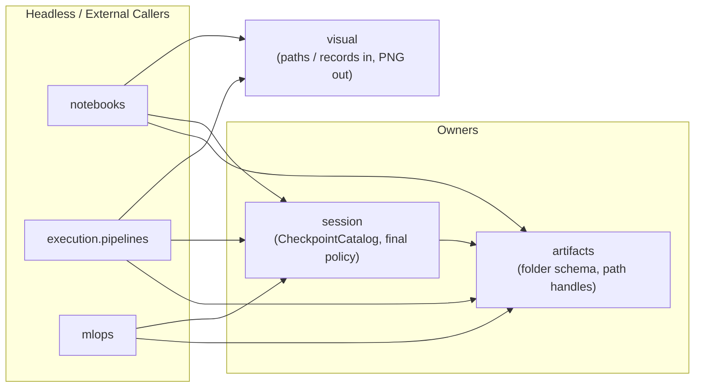

# ADR-0070: Artifact Path Handles and Final Checkpoint Resolution

**Status:** Accepted — Implemented 
**Date:** 2026-11-26 
**Target release:** v0.6.0 
**Related:**
[ADR-0063](ADR-0063-single-file-artifact-envelopes-and-schema-standardization.md),
[ADR-0067](ADR-0067-decoupled-stage-io-and-auxiliary-experiment-root.md),
[ADR-0069](ADR-0069-first-class-module-boundary-hardening-and-subsystem-streamlining.md) 

---

## 1. Context & Problem Statement

Commit `4ea4403` (`fix(visual): separate figure generation from notebook
rendering`) split `landseg.visual` into headless *generate* functions and
notebook *render* functions. That separated plotting from display, but left a
deeper boundary leak untouched: callers outside `landseg.artifacts` still had to
*infer* where artifacts lived, and no component owned the question "which
checkpoint is the result of this run?".

### 1.1. Layout Knowledge Leaked Out of `artifacts`
* `visual/curves.py` and `visual/preview.py` each carried a private copy of
  `_resolve_latest_run`, which globbed `**/step_results.json` under any
  directory and picked the newest by `st_mtime`.
* `visual/curves.py::_load_step_results` repeated the same recursive glob when
  given a directory, and imported `landseg.artifacts` solely to read the JSON.
* File and folder names (`plots/training_curves.png`, `previews/`, and
  `*_preview.png`) were hard-coded in `visual` rather than declared in
  `artifacts.paths.SessionPaths`, splitting the folder schema across two
  subsystems.
* Discovery by `st_mtime` was unreliable on copied trees (for example,
  `02_model_train` copying `/local_disk0` outputs to a UC Volume with
  `copytree`, where mtimes reflected copy order rather than training order).

### 1.2. Path Objects Mixed Reading with Allocation
* `PipelineArtifactsPaths.__post_init__` probed the filesystem and allocated
  the next free `run_XXXX` ID at construction time, while `trace_to_last` turned
  that into "latest existing run".
* `get_run_folder()` both resolved and *mutated* `run_folder`.
* Read-only callers (notebooks, `visual`, study analysis, `mlops`) could not
  open an existing run without side effects, and lacked a direct entry point
  from an experiment root, stage output folder, or single run folder.

### 1.3. No Canonical "Final" Checkpoint
* `session.orchestration.runner.base._save_progress` wrote
  `{phase}_epoch_last.pt` every epoch and `{phase}_epoch_best.pt` on
  improvement, once per curriculum phase.
* `ModelTraining._generate_post_run_visuals` picked
  `next(checkpoints.glob('*_best.pt'))`, which depended on filesystem order for
  multi-phase runs.
* `SessionPaths.phase_status` (`checkpoints/status.json`) was declared but
  nothing in `src/` wrote it.
* `mlops/registry.py` globbed `**/*.pt` and `mlops/storage.py` globbed
  `*trial_XXXX*.pt`, creating independent checkpoint discovery rules.

---

## 2. Decision & Governing Invariants

This ADR records the architectural change making `landseg.artifacts` the single
owner of the folder schema, giving external callers side-effect-free path
handles, and introducing `CheckpointCatalog` in `landseg.session` to resolve one
canonical final checkpoint per run.

### Invariant 1: `artifacts` Owns Every Name in the Folder Tree
Every directory and file name under an experiment root or a stage output root
is declared once, in `artifacts.paths`. That includes `step_results.json`,
`plots/training_curves.png`, `previews/{head}_preview.png`, checkpoints, and
the checkpoint catalog. No other subsystem builds artifact paths from string
literals or discovers them by glob.

### Invariant 2: `visual` Is Path-In / Path-Out and Imports No `artifacts`
`visual` receives concrete file paths or already-loaded records and returns the
paths it wrote. It never discovers runs, globs directories, or reads envelopes.
The `visual` → `artifacts` edge was removed from the dependency graph in
ADR-0069 §2.

### Invariant 3: Opening Is Side-Effect-Free; Allocation Is Explicit
Resolving an existing run never creates folders, allocates IDs, or mutates a
shared handle. Allocating a new run is a separate, named operation (`allocate_run`)
called only by writing pipelines.

### Invariant 4: One Final-Checkpoint Handle per Run, Owned by `session`
`artifacts` defines *where* checkpoints and their catalog live; `session`
defines *which* checkpoint is final. Consumers (`execution`, `mlops`, notebooks)
query `CheckpointCatalog` and never glob `*.pt`.

---

## 3. Implemented Design

### 3.1. Path Handles at Each Folder Level (`artifacts.paths`)

| Level | Entry Point | Returns |
| :--- | :--- | :--- |
| Experiment root | `ArtifactPaths.from_exp_root(exp_root)` | Facade using the conventional ADR-0067 layout |
| Config | `ArtifactPaths.from_config(config)` | Facade from explicit stage roots |
| Stage output root | `SessionPaths.from_root(root)` (and per stage) | Unbound stage handle; no allocation |
| Existing run | `<StagePaths>.open_run(root, run_id=None)` | Run-bound handle; `None` resolves latest by run ID |
| Run folder | `<StagePaths>.from_run_folder(run_dpath)` | Run-bound handle for a given `run_XXXX` folder |
| New run | `<StagePaths>.allocate_run(root)` | Run-bound handle for the next free ID (writers only) |
| Listing | `<StagePaths>.list_runs(root)` | Sorted run IDs, no side effects |

* Run-bound `SessionPaths` handles expose every declared artifact path via
  properties and methods: `step_results`, `training_curves`, `previews`,
  `preview(head)`, `list_previews()`, `per_class_plot(head)`,
  `confusion_matrix_plot(head)`, `checkpoints`, `best_checkpoint(name)`,
  `last_checkpoint(name)`, `checkpoint_catalog`, `evaluation`, `config`, and
  `report`.
* `get_run_folder()`, `trace_to_last`, and implicit run allocation in
  `__post_init__` were removed cleanly, and all callers (including
  `geopipe/ingest/context.py`) were migrated to `open_run` and `allocate_run`.
* `artifacts.resolve_session_run(path, run_id=None)` accepts an experiment
  root, a session results root, or a run folder, classifies the input by schema
  markers (`RUN_DIR_RE` and declared stage sub-roots) without recursive globbing,
  and raises `ArtifactError` with the expected layout when no level matches.

### 3.2. `visual` Decoupling
* `generate_training_curves(step_records, save_fpath)` accepts already-loaded
  step records (`list[dict[str, Any]]`) and an explicit target file path. Callers
  load `run.step_results` through `artifacts.Controller`.
* `generate_prediction_previews(infer_results, dataspecs, save_fpaths)` accepts
  a `dict[str, pathlib.Path]` mapping each head to its target PNG path, built by
  the caller from `run.preview(head)`.
* `render_training_curves(png_fpath)` and
  `render_prediction_preview(png_fpaths)` display the given files only.
* Both copies of `_resolve_latest_run`, the directory branch of
  `_load_step_results`, and the `landseg.artifacts` import in `visual/curves.py`
  were removed.
* Notebooks (such as `02_model_train.ipynb`) resolve the run once via
  `artifacts.resolve_session_run(...)` and pass `run.training_curves` and
  `run.list_previews()` directly to the render calls.

### 3.3. Checkpoint Catalog & Final Checkpoint (`session.orchestration.catalog`)
* **Catalog file**: The training runner writes a single-file JSON envelope
  (ADR-0063) at `run.checkpoint_catalog` (`checkpoints/status.json`, schema
  `checkpoint_catalog/v0.1.0`), updated on checkpoint save and at phase end.
  Each `PhaseCheckpointEntry` records `best_fpath`, `last_fpath`, `best_epoch`,
  `best_metric`, `last_epoch`, and `completed`, with paths stored relative to
  the run folder so copied trees remain valid.
* **Handle**: `CheckpointCatalog` lives in `landseg.session.orchestration.catalog`
  and is exported from both `landseg.session` and `landseg.session.orchestration`.
  `CheckpointCatalog.from_run(run)` exposes `phases`, `best(phase)`,
  `last(phase)`, and `final`.
* **Final policy**: `final` is resolved dynamically from `phases` using the
  `last_phase_best` policy:
  * single-phase run: the best checkpoint of that phase;
  * multi-phase run: the best checkpoint of the highest-indexed phase that has
    a best checkpoint.
* **Legacy runs**: When `checkpoints/status.json` is absent, `from_run` accepts
  a single legacy `*_best.pt` file under `run.checkpoints`, and raises
  `ArtifactError` naming the candidates when zero or multiple files exist.
* **Consumers**: `ModelTraining._generate_post_run_visuals` resolves the
  checkpoint via `CheckpointCatalog.from_run(run).final`. Checkpoint lookup in
  `mlops/registry.py` and `mlops/storage.py` was migrated to `SessionPaths`
  and `CheckpointCatalog`.

---

## 4. Scope of Changes

* **`artifacts.paths`**: Added schema-owned session file names, side-effect-free
  run handles (`from_root`, `open_run`, `from_run_folder`, `list_runs`), explicit
  `allocate_run`, and `resolve_session_run`; removed `get_run_folder`,
  `trace_to_last`, and implicit `__post_init__` allocation; exposed `RUN_DIR_RE`
  as public in `paths.base`.
* **`session.orchestration.catalog`**: Added `CheckpointCatalog` and
  `PhaseCheckpointEntry`, integrated catalog updates into the runner lifecycle,
  and implemented `last_phase_best` with legacy single-file fallback.
* **`visual`**: Switched `curves.py` and `preview.py` to path-in / path-out
  signatures, removed run discovery, and dropped all `landseg.artifacts` imports.
* **`execution`, `mlops`, `study`, and notebooks**: Migrated pipelines, sweep
  storage/registry lookups, and `02_model_train.ipynb` to path handles and
  `CheckpointCatalog.from_run(run).final`.
* **Documentation & versioning**: Updated `README.md`, `README_fr.md`,
  `docs/ARCHITECTURE.md`, `docs/project_structure*.md`,
  `docs/experiment_directory_layout*.md`, and the ADR-0069 dependency graph;
  bumped package version to `v0.6.0`.

---

## 5. Verification

* **Unit & integration coverage**: Added unit tests for `artifacts.paths`
  handles and `resolve_session_run` (`tests/unit/artifacts`), `CheckpointCatalog`
  and `last_phase_best` (`tests/unit/session/orchestration/test_catalog.py`),
  and updated `visual`, `execution`, and `mlops` test suites to use explicit
  paths and catalog handles.
* **Boundary invariants**: Verified `landseg.visual` carries zero imports from
  `landseg.artifacts` and no directory/checkpoint globbing remains in `visual`,
  `execution`, or `mlops`.

---

## 6. Consequences

### Positive
* `visual` is a pure presentation layer that any headless caller can drive with
  plain paths and in-memory records.
* The folder schema is defined once in `artifacts.paths`, so layout changes
  touch a single subsystem.
* Every run has a deterministic, documented final checkpoint behind a single
  policy extension point.
* Reading runs never allocates directories or mutates state, making notebooks
  and analysis tools safe against shared or copied experiment trees.

### Trade-offs & Neutral Notes
* **Breaking public API**: `visual` signatures and `PipelineArtifactsPaths`
  construction semantics changed, motivating the `v0.6.0` version bump.
* **Extra artifact**: One small JSON envelope (`checkpoints/status.json`) is
  rewritten on each checkpoint save via whole-file writes.
* **Placeholder policy**: `last_phase_best` can select a checkpoint with a worse
  metric than an earlier phase's best; multi-phase selection policies remain a
  future extension behind `CheckpointCatalog.final`.
* **Legacy runs**: Multi-phase runs created before `v0.6.0` require an explicit
  checkpoint path because the legacy fallback refuses to guess among multiple
  `*_best.pt` files.

---

## 7. Alternatives Considered

* **Keep discovery by glob/mtime in callers**: Rejected because it is fragile on
  copied trees and duplicates folder schema knowledge across subsystems.
* **Put the final-checkpoint policy in `artifacts`**: Rejected because selecting
  a training checkpoint is a session concern; `artifacts` owns where files live.
* **Write a physical `final.pt` copy or symlink**: Deferred because copying
  doubles checkpoint storage and symlink support on UC Volumes is unverified.

---

## 8. Resolved Decisions

1. **Dynamic `final` resolution**: `CheckpointCatalog.final` is computed
   dynamically from `phases` using `'policy': 'last_phase_best'` stored in
   `checkpoints/status.json` rather than persisting a frozen `final_fpath`.
2. **Study sweeps**: A full study-level checkpoint catalog remains out of
   scope; `study.sweep.objectives` records each trial's `run_folder` in Optuna
   `trial.user_attrs`, and `mlops.storage.sync_optuna_study` resolves the
   winning trial via `SessionPaths.from_run_folder(...)` and
   `CheckpointCatalog.from_run(run).final`.
3. **Clean API cut**: `get_run_folder`, `trace_to_last`, and implicit
   `__post_init__` run allocation were removed cleanly with all internal callers
   and tests migrated in the same branch.
