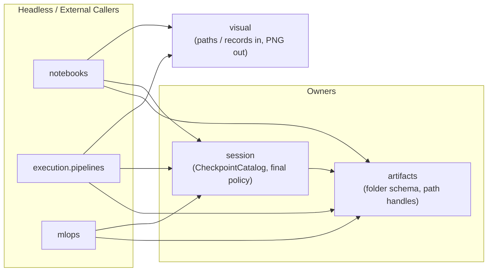

# ADR-0070: Artifact Path Handles and Final Checkpoint Resolution

**Status:** Proposed 
**Date:** 2026-11-26 
**Target release:** v0.6.0 
**Related:**
[ADR-0063](ADR-0063-single-file-artifact-envelopes-and-schema-standardization.md),
[ADR-0067](ADR-0067-decoupled-stage-io-and-auxiliary-experiment-root.md),
[ADR-0069](ADR-0069-first-class-module-boundary-hardening-and-subsystem-streamlining.md) 

---

## 1. Context & Problem Statement

Commit `4ea4403` (`fix(visual): separate figure generation from notebook
rendering`) split `landseg.visual` into headless *generate* functions and
notebook *render* functions. That fixed the mixing of plotting with display,
but it left the deeper problem untouched: callers outside `landseg.artifacts`
still have to *infer* where artifacts live, and no component owns the question
"which checkpoint is the result of this run?".

### 1.1. Layout Knowledge Leaks Out of `artifacts`
* `visual/curves.py` and `visual/preview.py` each carry a private copy of
  `_resolve_latest_run`, which globs `**/step_results.json` under any directory
  and picks the newest by `st_mtime`.
* `visual/curves.py::_load_step_results` repeats the same recursive glob when it
  is given a directory, and imports `landseg.artifacts` only to read the JSON.
* File and folder names are hard-coded in `visual`: `plots/training_curves.png`,
  `previews/` and `*_preview.png`. They are not declared in
  `artifacts.paths.SessionPaths`, so the folder schema is split across two
  subsystems.
* Discovery by mtime is unreliable on copied trees. For example,
  `02_model_train` copies `/local_disk0` outputs back to a UC Volume with
  `copytree`, so mtimes describe the copy, not the training order.

### 1.2. Path Objects Mix Reading with Allocation
* `PipelineArtifactsPaths.__post_init__` probes the filesystem and allocates
  the next free `run_XXXX` ID at construction time. `trace_to_last` turns this
  into "latest existing run".
* `get_run_folder()` both resolves and *mutates* `run_folder`.
* So a read-only caller (notebook, `visual`, study analysis, `mlops`) cannot
  open an existing run without knowing these side effects. There is also no
  cheap entry point from an experiment root, a stage output folder, or a single
  run folder. `ArtifactPaths` is built from `RootConfig` or from explicit stage
  roots.

### 1.3. No Canonical "Final" Checkpoint
* `session.orchestration.runner.base._save_progress` writes
  `{phase}_epoch_last.pt` every epoch and `{phase}_epoch_best.pt` on
  improvement, once per curriculum phase.
* `ModelTraining._generate_post_run_visuals` takes
  `next(checkpoints.glob('*_best.pt'))`. With more than one phase, the result
  depends on filesystem order; the code carries a `TODO` for this.
* `SessionPaths.phase_status` (`checkpoints/status.json`) is declared but
  nothing in `src/` writes it.
* `mlops/registry.py` globs `**/*.pt` and `mlops/storage.py` globs
  `*trial_XXXX*.pt`. These are further independent checkpoint discovery rules.

---

## 2. Decision & Governing Invariants

This ADR proposes making `landseg.artifacts` the single owner of the folder
schema, giving external callers explicit path handles, and giving
`landseg.session` a small checkpoint catalogue that names one final checkpoint
per run.

### Invariant 1: `artifacts` Owns Every Name in the Folder Tree
Every directory and file name under an experiment root or a stage output root
is declared once, in `artifacts.paths`. That includes `step_results.json`,
`plots/training_curves.png`, `previews/{head}_preview.png`, checkpoints, and
the checkpoint catalogue. No other subsystem builds artifact paths from string
literals or discovers them by glob.

### Invariant 2: `visual` Is Path-In / Path-Out and Imports No `artifacts`
`visual` receives concrete file paths, or already-loaded records, and returns
the paths it wrote. It never discovers runs, globs directories, or reads
envelopes. `visual` → `artifacts` is removed from the dependency graph in
ADR-0069 §2.

### Invariant 3: Opening Is Side-Effect-Free; Allocation Is Explicit
Resolving an existing run never creates folders, allocates IDs, or mutates a
shared handle. Allocating a new run is a separate, named operation that only
writing pipelines call.

### Invariant 4: One Final-Checkpoint Handle per Run, Owned by `session`
`artifacts` defines *where* checkpoints and their catalogue live; `session`
defines *which* checkpoint is final. Consumers (`execution`, `mlops`,
notebooks) ask the catalogue and never glob `*.pt`.

---

## 3. Proposed Design

Names below are proposed. They may change during implementation, but the
responsibilities may not.

### 3.1. Path Handles at Each Folder Level (`artifacts.paths`)

| Level | Proposed entry point | Returns |
| :--- | :--- | :--- |
| Experiment root | `ArtifactPaths.from_exp_root(exp_root)` | Facade using the conventional ADR-0067 layout |
| Config | `ArtifactPaths.from_config(config)` (existing) | Facade from explicit stage roots |
| Stage output root | `SessionPaths.from_root(root)` (and per stage) | Unbound stage handle; no allocation |
| Existing run | `<StagePaths>.open_run(root, run_id=None)` | Run-bound handle; `None` means latest by run ID, not by mtime |
| Run folder | `<StagePaths>.from_run_folder(run_dpath)` | Run-bound handle for a given `run_XXXX` folder |
| New run | `<StagePaths>.allocate_run(root)` | Run-bound handle for the next free ID (writers only) |
| Listing | `<StagePaths>.list_runs(root)` | Sorted run IDs, no side effects |

* Run-bound session handles expose every file named in Invariant 1 as a property
  or method, for example `step_results`, `training_curves`, `previews`,
  `preview(head)`, `checkpoints`, `best_checkpoint(phase)`,
  `last_checkpoint(phase)`, `checkpoint_catalog`, `evaluation`, `config` and
  `report`.
* Run-bound handles are frozen and resolving a run never mutates a handle.
  `get_run_folder()` and `trace_to_last` are deprecated in favour of
  `open_run` and `allocate_run`, and the implicit allocation in
  `__post_init__` is removed. Existing callers (for example
  `geopipe/ingest/context.py`) migrate in the same change.
* A convenience resolver,
  `artifacts.resolve_session_run(path, run_id=None)`, accepts an experiment
  root, a session results root, or a run folder. It classifies the input by
  schema markers (the `run_XXXX` name pattern and declared stage sub-roots),
  not by recursive glob, and raises `ArtifactError` with the expected layout
  when the input matches no level.

### 3.2. `visual` Decoupling
* `generate_training_curves(step_records, save_fpath) -> pathlib.Path` takes
  already-loaded step records (`Sequence[Mapping]`) and an explicit target
  file. The caller loads `run.step_results` through `artifacts.Controller`.
* `generate_prediction_previews(infer_results, dataspecs, save_fpaths)` takes a
  `Mapping[str, pathlib.Path]` from head to target file, built by the caller
  from `run.preview(head)`.
* `render_training_curves(png_fpath)` and
  `render_prediction_preview(png_fpaths)` display the given files only.
* `_resolve_latest_run` (both copies) and the directory branch of
  `_load_step_results` are removed. `visual` no longer imports
  `landseg.artifacts`; today only `visual/curves.py` imports it.
* Notebooks resolve paths once, for example
  `run = artifacts.resolve_session_run(resolved_output_dpath)`, and pass
  `run.training_curves` or `run.previews` to the render calls.

### 3.3. Checkpoint Catalogue & Final Checkpoint (`session`)
* **Catalogue file**: the runner keeps a single-file envelope (ADR-0063) at
  `run.checkpoint_catalog`, which reuses the declared `checkpoints/status.json`
  path. It is updated in `_save_progress` and at phase end. Each phase entry
  records `phase_name`, `phase_index`, `best_fpath`, `best_metric`,
  `best_epoch`, `last_fpath` and `is_complete`, with file paths stored relative
  to the run folder so copied trees stay valid.
* **Handle**: `session.CheckpointCatalog.from_run(run)` exposes `phases`,
  `best(phase)`, `last(phase)` and `final`.
* **Final policy (stub)**: `final` is resolved by a single named policy,
  `last_phase_best`:
  * single-phase run: the best checkpoint of that phase;
  * multi-phase run: the best checkpoint of the highest `phase_index` that has
    a best checkpoint.
  This is a deliberately simple placeholder. Real multi-phase selection (for
  example cross-phase metric comparison, head-specific finals or ensembling) is
  out of scope and will extend the policy behind the same `final` handle.
* **Legacy runs** (no catalogue file): if exactly one `*_best.pt` exists, use
  it. Otherwise raise an explicit error naming the candidates instead of
  guessing by mtime or glob order.
* **Consumers**: `ModelTraining._generate_post_run_visuals` uses
  `CheckpointCatalog.from_run(run).final`. Checkpoint discovery in
  `mlops/registry.py` and `mlops/storage.py` is audited and routed through the
  catalogue where it refers to a single run.

---

## 4. Implementation Plan

Each step is a scoped commit on a feature branch, squash-merged with this ADR
moved to **Accepted**:

1. `refactor(artifacts)`: add schema-owned file names, the run-bound handles,
   `open_run`, `allocate_run`, `from_run_folder`, `list_runs` and
   `resolve_session_run`; migrate writers to explicit allocation; deprecate
   `trace_to_last` and `get_run_folder`.
2. `feat(session)`: add `CheckpointCatalog`, write the catalogue from the
   runner, and add the `last_phase_best` policy with the legacy fallback.
3. `refactor(visual)`: switch to path-in / path-out signatures, remove run
   discovery, and drop the `artifacts` import.
4. `refactor(execution)`, notebooks and `mlops`: consume the handles and
   `final`; update `02_model_train`.
5. `docs`: update `docs/ARCHITECTURE.md`, `docs/project_structure*.md` and the
   ADR-0069 dependency graph; bump to v0.6.0.

---

## 5. Verification Plan

* **Unit (`tests/unit/artifacts`)**: each entry point resolves the expected
  paths on a small `tmp_path` tree; `open_run` and `list_runs` create nothing;
  `allocate_run` picks the next ID; `resolve_session_run` classifies an
  experiment root, a results root and a run folder, and rejects a foreign
  folder.
* **Unit (`tests/unit/session`)**: the catalogue round-trips;
  `final` covers single-phase, multi-phase (last phase wins even when an
  earlier phase has a better metric), a missing best in the last phase, and
  the legacy one-file and many-file cases.
* **Unit (`tests/unit/visual`)**: tests pass explicit files and records only.
* **Boundary checks**: an AST scan finds no `landseg.artifacts` import in
  `src/landseg/visual/`, and a grep finds no `glob(` in `visual` and no
  `'*_best.pt'` or `'**/*.pt'` literal outside `artifacts` and `session`.
* **Integration**: a dummy-data multi-phase `model-train` run writes a
  catalogue whose `final` is the last phase's best, and post-run previews use
  it.
* **Full suite**: no regressions against the current baseline.

---

## 6. Consequences

### Positive
* `visual` becomes a pure presentation layer that any headless caller can
  drive with plain paths.
* The folder schema is defined once, so layout changes touch one subsystem.
* Every run has a deterministic, documented final checkpoint, and the
  multi-phase policy has a clear extension point.
* Reading never allocates, which makes notebooks and analysis tools safe to run
  against shared or copied experiment trees.

### Trade-offs & Neutral Notes
* **Breaking public API**: `visual` signatures change again (after v0.5.0 and
  `4ea4403`), and the semantics of `PipelineArtifactsPaths` construction
  change. Hence v0.6.0.
* **Extra artifact**: one small JSON envelope per run, rewritten on each
  checkpoint save. `02_model_train` already trains on local scratch and
  copies outputs to UC Volumes afterwards; direct-to-Volume writers must use
  whole-file writes, never appends.
* **Placeholder policy**: `last_phase_best` can pick a worse checkpoint than an
  earlier phase's best. This is accepted until multi-phase training is
  designed properly.
* **Legacy runs**: multi-phase runs written before this change need an explicit
  checkpoint path, because the resolver refuses to guess.

---

## 7. Alternatives Considered

* **Keep discovery by glob/mtime in callers**: rejected. It is fragile on copied
  trees and duplicates schema knowledge.
* **Put the final-checkpoint policy in `artifacts`**: rejected. Choosing a
  checkpoint is a training decision; `artifacts` should only know where files
  live.
* **Write a physical `final.pt` copy or symlink**: deferred. It doubles
  checkpoint storage, and symlink support on UC Volumes is unverified. A later export
  step could materialize it from `final` if registry tooling needs it.

---

## 8. Open Questions

* Should `final` be persisted in the catalogue at run end (a frozen decision)
  or always computed from the policy (re-evaluated if the policy changes)?
* Should study sweeps (`mlops/storage.py`, `{study_name}_best.pt`) get a
  study-level catalogue, or stay out of scope until multi-phase work?
