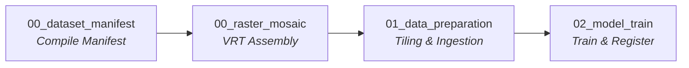

# Landseg Interactive Notebooks

This directory contains production-ready interactive Jupyter notebooks
designed for multi-environment execution across Databricks cloud clusters
and local developer sandboxes.

---

## Supported Use Cases

Workflows in this repository are architected around three explicit
execution tiers (see
[ADR-0066](../docs/ADRs/ADR-0066-production-notebook-architecture-and-databricks-integration.md)):

```text
+--------------------------------------------------------------------------------+
| Tier 1: Production Automated Pipeline (Headless Engine)                        |
| - Primary: CLI execution with YAML recipes (`landseg --config recipe.yaml`)    |
| - Secondary: Automated Databricks Workflows / DABs invoking notebooks          |
+--------------------------------------------------------------------------------+
                                       |
                                       v
+--------------------------------------------------------------------------------+
| Tier 2: Interactive Researcher Exploration (Databricks Workspaces)             |
| - Target Audience: Geospatial researchers, data scientists, domain colleagues  |
| - Environment: Databricks cluster with wheel pre-installed via init script     |
| - UX: Interactive widgets (`NotebookWidgets`), live telemetry, UC registration |
+--------------------------------------------------------------------------------+
                                       |
                                       v
+--------------------------------------------------------------------------------+
| Tier 3: Local Developer Sandbox (VS Code / Local Workstation)                  |
| - Target Audience: Core framework developers & CI verification                 |
| - Environment: Local `.venv` with `pip install -e ".[dev]"`                    |
| - UX: Headless fallback for widgets, fast feedback loop, full test coverage    |
+--------------------------------------------------------------------------------+
```

### 1. Tier 1: Production Automated Compute (Headless)
- **Primary Interface**: Headless terminal CLI (`landseg.adapters.cli`) driven
  by Hydra/YAML configuration recipes.
- **Scheduled Notebook Execution**: When deployed in Databricks Workflows or
  Databricks Asset Bundles (DABs), the notebooks run end-to-end headlessly.
  Task parameters passed via Databricks Jobs are automatically captured by
  `landseg.notebooks.NotebookWidgets`.

### 2. Tier 2: Interactive Researcher Exploration (Databricks)
- **Target Audience**: Data scientists and domain colleagues exploring data,
  tuning hyperparameter sweeps, or analyzing predictions.
- **Zero-Boilerplate Setup**: Compute clusters must have the `landseg` wheel
  pre-installed (via cluster init scripts or cluster libraries). Notebooks
  require **no in-notebook `%pip install` commands**.
- **Interactive UX**: Users adjust parameters using native Databricks UI widgets
  (dropdowns, integer sliders, checkboxes), inspect in-cell loss/mIoU curves,
  and publish validated models directly to the Unity Catalog Model Registry.

### 3. Tier 3: Local Developer Sandbox (VS Code)
- **Target Audience**: Core library developers creating new features or
  fixing bugs.
- **Environment**: Local repository checkout inside the project's virtual
  environment (`.venv`) with `pip install -e ".[dev]"`.
- **Headless Fallback**: `NotebookWidgets` operates silently without requiring
  `ipywidgets` or GUI dependencies, falling back to typed defaults for seamless
  local execution and CI testing.

---

## Notebook Catalog

| Notebook | Purpose | Key Capabilities |
| :--- | :--- | :--- |
| [`00_dataset_manifest.ipynb`](00_dataset_manifest.ipynb) | Raw data manifest construction | Fluent `DatasetManifestBuilder` API, fail-fast raster contract validation, single-document YAML/JSON export. |
| [`00_raster_mosaic.ipynb`](00_raster_mosaic.ipynb) | Multi-tile / cross-UTM mosaicking | GDAL Virtual Raster (`.vrt`) assembly without pixel duplication, cross-projection warping into `EPSG:3161`. |
| [`01_data_preparation.ipynb`](01_data_preparation.ipynb) | End-to-end data preparation | Spatial world grid generation, data harmonization ETL, multi-batch ingestion, feature channel selection, and splitting. |
| [`02_model_train.ipynb`](02_model_train.ipynb) | Baseline model training | `TrainingSessionConfigurator`, in-cell telemetry, qualitative segmentation previews, interruption safety, and Unity Catalog model registration. |
| [`03_study_sweep.ipynb`](03_study_sweep.ipynb) | Hyperparameter study sweeps | `StudySweepConfigurator` backed by Optuna, two-tiered storage (driver `/tmp/` vs Unity Catalog Volumes) to prevent distributed locking failures. |

---

## Prerequisites & Compute Configuration

### Databricks Compute Cluster
- **Databricks Runtime**: 15.x+ (Python 3.12+ recommended).
- **GPU Node**: Single-node or multi-node with NVIDIA GPU (T4, A10G, or A100)
  for training and sweeps.
- **Init Script**: Cluster init script or cluster-scoped library installing the
  latest `landseg-*.whl` package:
  ```bash
  pip install /Volumes/<catalog>/<schema>/<volume>/wheels/landseg-0.2.1-py3-none-any.whl
  ```

### Local Development
- Python 3.12 virtual environment at the project root:
  ```bash
  uv venv .venv --python 3.12
  uv pip install -e ".[dev]"
  ```

---

## Reference Databricks Workflow (Multi-Task Job)

When orchestrating these notebooks in an enterprise Databricks Workflow,
tasks can be chained in sequence with parameter forwarding:



Example Databricks Workflow task configuration snippet:

```yaml
tasks:
  - task_key: 00_dataset_manifest
    notebook_task:
      notebook_path: notebooks/00_dataset_manifest.ipynb
      base_parameters:
        exp_root: "/Volumes/main/landcover/experiments/exp_01"

  - task_key: 00_raster_mosaic
    depends_on:
      - task_key: 00_dataset_manifest
    notebook_task:
      notebook_path: notebooks/00_raster_mosaic.ipynb

  - task_key: 01_data_preparation
    depends_on:
      - task_key: 00_raster_mosaic
    notebook_task:
      notebook_path: notebooks/01_data_preparation.ipynb
      base_parameters:
        crs: "EPSG:3161"
        tile_size: "256"
        tile_stride: "128"

  - task_key: 02_model_train
    depends_on:
      - task_key: 01_data_preparation
    notebook_task:
      notebook_path: notebooks/02_model_train.ipynb
      base_parameters:
        batch_size: "16"
        patch_size: "128"
        max_epochs: "5"
        register_model: "true"
        catalog: "main"
        schema: "landcover"
        model_name: "landseg_unet"
```
