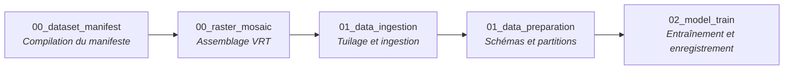

# Notebooks interactifs Landseg

[English](README.md) | [Français](README_fr.md)

Ce répertoire contient des notebooks Jupyter interactifs prêts pour la production,
conçus pour une exécution multi-environnements sur les clusters cloud Databricks
et les bacs à sable de développement locaux.

---

## Cas d'utilisation pris en charge

Les flux de travail de ce dépôt sont articulés autour de trois niveaux
d'exécution explicites (voir
[ADR-0066](../docs/ADRs/ADR-0066-production-notebook-architecture-and-databricks-integration.md)) :

```text
+--------------------------------------------------------------------------------+
| Niveau 1 : Pipeline automatisé de production (Moteur headless)                 |
| - Principal : Exécution CLI avec recettes YAML (`landseg --config recipe.yaml`)|
| - Secondaire : Workflows Databricks automatisés / DABs invoquant les notebooks |
+--------------------------------------------------------------------------------+
                                       |
                                       v
+--------------------------------------------------------------------------------+
| Niveau 2 : Exploration interactive pour les chercheurs (Espaces Databricks)    |
| - Public cible : Chercheurs géospatiaux, data scientists, collègues métier     |
| - Environnement : Cluster Databricks avec wheel préinstallé via script d'init  |
| - UX : Widgets interactifs (`NotebookWidgets`), télémétrie, enregistrement UC  |
+--------------------------------------------------------------------------------+
                                       |
                                       v
+--------------------------------------------------------------------------------+
| Niveau 3 : Bac à sable de développement local (VS Code / Station locale)       |
| - Public cible : Développeurs du cœur du framework & vérification CI           |
| - Environnement : `.venv` local avec `pip install -e ".[dev]"`                 |
| - UX : Repli headless pour widgets, boucle de retour rapide, tests exhaustifs  |
+--------------------------------------------------------------------------------+
```

### 1. Niveau 1 : Calcul automatisé de production (Headless)
- **Interface principale** : CLI en terminal sans interface graphique (`landseg.adapters.cli`)
  pilotée par des recettes de configuration Hydra/YAML.
- **Exécution programmée de notebooks** : Lorsqu'ils sont déployés dans des
  Databricks Workflows ou des Databricks Asset Bundles (DABs), les notebooks
  s'exécutent de bout en bout en mode headless. Les paramètres de tâche transmis
  via les Jobs Databricks sont automatiquement capturés par
  `landseg.notebooks.NotebookWidgets`.

### 2. Niveau 2 : Exploration interactive pour les chercheurs (Databricks)
- **Public cible** : Data scientists et collègues spécialistes du domaine explorant
  les données, ajustant les balayages d'hyperparamètres ou analysant les prédictions.
- **Configuration zéro code récurrent (Zero-Boilerplate)** : Les clusters de calcul
  doivent disposer du package wheel `landseg` préinstallé (via des scripts
  d'initialisation de cluster ou des bibliothèques de cluster). Les notebooks ne
  requièrent **aucune commande `%pip install` dans les cellules**.
- **Expérience utilisateur (UX) interactive** : Les utilisateurs ajustent les
  paramètres à l'aide des widgets d'interface natifs de Databricks (menus déroulants,
  curseurs d'entiers, cases à cocher), inspectent les courbes de perte/mIoU
  directement dans les cellules, et publient les modèles validés directement dans
  le registre de modèles Unity Catalog (Model Registry).

### 3. Niveau 3 : Bac à sable de développement local (VS Code)
- **Public cible** : Développeurs du framework central créant de nouvelles
  fonctionnalités ou corrigeant des anomalies.
- **Environnement** : Clone local du dépôt au sein de l'environnement virtuel du
  projet (`.venv`) avec `pip install -e ".[dev]"`.
- **Repli en mode headless (Headless Fallback)** : `NotebookWidgets` fonctionne
  silencieusement sans nécessiter `ipywidgets` ni dépendance d'interface graphique,
  en se repliant sur des valeurs par défaut typées pour une exécution locale et des
  tests CI fluides.

---

## Catalogue des notebooks

| Notebook | Objectif | Capacités clés |
| :--- | :--- | :--- |
| [`00_dataset_manifest.ipynb`](00_dataset_manifest.ipynb) | Construction du manifeste de données brutes | API fluide `DatasetManifestBuilder`, validation contractuelle raster à échec rapide (*fail-fast*), export YAML/JSON sous document unique. |
| [`00_raster_mosaic.ipynb`](00_raster_mosaic.ipynb) | Mosaïquage multi-dalles / multi-zones UTM | Assemblage de rasters virtuels GDAL (`.vrt`) sans duplication de pixels, reprojection et rééchantillonnage (*warping*) vers `EPSG:3161`. |
| [`01_data_preparation.ipynb`](01_data_preparation.ipynb) | Préparation des données de bout en bout | Génération de grille spatiale mondiale (*world grid*), ETL d'harmonisation des données, ingestion multi-lots, sélection des canaux de caractéristiques et partitionnement (*splitting*). |
| [`02_model_train.ipynb`](02_model_train.ipynb) | Entraînement du modèle de référence (*baseline*) | `TrainingSessionConfigurator`, télémétrie en cellule, prévisualisations qualitatives de segmentation, sécurité face aux interruptions et enregistrement du modèle dans Unity Catalog. |
| [`03_study_sweep.ipynb`](03_study_sweep.ipynb) | Balayages d'études d'hyperparamètres (*sweeps*) | `StudySweepConfigurator` basé sur Optuna, stockage à deux niveaux (`/tmp/` du nœud maître vs Volumes Unity Catalog) pour éviter les blocages de verrous distribués. |

---

## Prérequis et configuration de calcul

### Cluster de calcul Databricks
- **Runtime Databricks** : 15.x+ (Python 3.12+ recommandé).
- **Nœud GPU** : Nœud unique ou multi-nœuds avec GPU NVIDIA (T4, A10G ou A100)
  pour l'entraînement et les balayages.
- **Script d'initialisation (Init Script)** : Script d'init de cluster ou bibliothèque
  de cluster installant le dernier package `landseg-*.whl` :
  ```bash
  pip install /Volumes/<catalog>/<schema>/<volume>/wheels/landseg-0.2.1-py3-none-any.whl
  ```

### Développement local
- Environnement virtuel Python 3.12 à la racine du projet :
  ```bash
  uv venv .venv --python 3.12
  uv pip install -e ".[dev]"
  ```

---

## Workflow Databricks de référence (Job multi-tâches)

Lors de l'orchestration de ces notebooks au sein d'un Databricks Workflow
d'entreprise, les tâches peuvent être enchaînées en séquence avec transmission
des paramètres :



Exemple d'extrait de configuration de tâche pour un Workflow Databricks :

```yaml
tasks:
  - task_key: 00_dataset_manifest
    notebook_task:
      notebook_path: notebooks/00_dataset_manifest.ipynb
      base_parameters:
        exp_root: "/Volumes/main/landcover/experiments/exp_01"

  - task_key: 00_raster_mosaic
    depends_on:
      - task_key: 00_dataset_manifest
    notebook_task:
      notebook_path: notebooks/00_raster_mosaic.ipynb

  - task_key: 01_data_ingestion
    depends_on:
      - task_key: 00_raster_mosaic
    notebook_task:
      notebook_path: notebooks/01_data_ingestion.ipynb
      base_parameters:
        01_exp_root: "/Volumes/main/landcover/experiments/exp_01"
        02_use_dummy_data: "false"
        03_reference_raster: "/Volumes/main/landcover/experiments/exp_01/input/reference_raster/extent.tif"
        04_raw_manifest: "/Volumes/main/landcover/experiments/exp_01/input/raw_data/manifest.json"
        11_tile_size: "256"
        12_tile_stride: "128"

  - task_key: 01_data_preparation
    depends_on:
      - task_key: 01_data_ingestion
    notebook_task:
      notebook_path: notebooks/01_data_preparation.ipynb
      base_parameters:
        01_ingest_root: "/Volumes/main/landcover/experiments/exp_01/artifacts/ingested_data"
        02_prep_output: "/Volumes/main/landcover/experiments/exp_01/artifacts/prepared_data"
        12_val_ratio: "0.2"

  - task_key: 02_model_train
    depends_on:
      - task_key: 01_data_preparation
    notebook_task:
      notebook_path: notebooks/02_model_train.ipynb
      base_parameters:
        batch_size: "16"
        patch_size: "128"
        max_epochs: "5"
        register_model: "true"
        catalog: "main"
        schema: "landcover"
        model_name: "landseg_unet"
```
